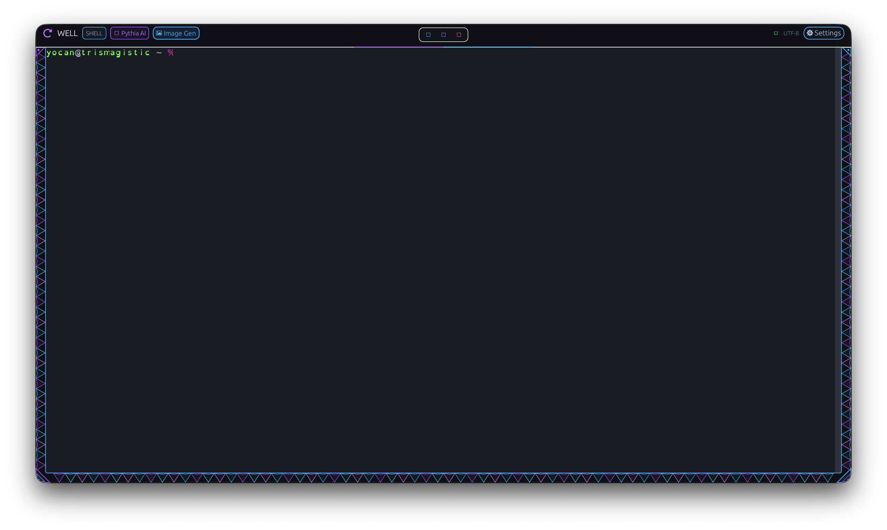

# Well

Well is an experimental, local-first workspace for working with AI agents in a
native terminal environment. The project brings a Rust desktop terminal,
shell/PTY support, configuration, editing, rendering, and local automation
components together so users and agents can work in the same environment.

Well is not an operating-system kernel or a distributed-computing platform.
It is a prototype under active development, not a release-ready terminal or
complete AgentOS. Some workspace crates and documented subsystem ideas are
not yet fully integrated into the desktop application.

## Current application

The desktop app creates a native window, starts an interactive PTY shell,
renders the terminal through `wgpu`, and exposes terminal controls and the
Theia configuration panel. The app also includes shell input, selection and
clipboard handling, scrollback search, a command palette, and the Pythia
translation/diagnostics interface. See the source and tests for the exact
current behavior; keyboard shortcuts are listed below.

### Screenshot



## Workspace

| Component | Responsibility |
| --- | --- |
| `well` (`src/`) | Native window, terminal display, input, configuration UI, and application event loop |
| `well-shell` | PTY sessions, shell execution, keyboard handling, and command pipeline support |
| `well-render` | GPU rendering, terminal graphics protocol handling, and visual effects |
| `well-config` | Theia settings UI and Hyprlang configuration parsing |
| `well-ipc` | Shared state, queues, and local application/RPC interfaces |
| `well-editor` | Rope-backed text editing primitives |
| `well-prompt` | Prompt formatting |
| `well-llm` | Online and offline language-model helpers used by Pythia |
| `well-history` | Local command/event history support |
| `well-cli`, `well-ffi`, `well-server` | CLI, FFI, and headless server entry points |

The workspace also contains metrics, SSH, and WebAssembly components. Their
integration and support status varies; a crate existing in the workspace does
not imply that the desktop currently exposes that capability.

## Controls

| Shortcut | Action |
| --- | --- |
| `Cmd+,` / `Ctrl+,`, `F1`, or `F12` | Toggle Theia settings |
| `Cmd+I` / `Ctrl+I` | Toggle the Pythia panel |
| `Cmd+Shift+P` / `Ctrl+Shift+P` | Open the command palette |
| `Cmd+F` / `Ctrl+F` | Search terminal scrollback |
| `Cmd+C` / `Ctrl+Shift+C` | Copy selected terminal text |
| `Cmd+V` / `Ctrl+Shift+V` | Paste into the terminal |
| `Cmd+K` | Clear the terminal buffer |
| `Cmd+=` / `Cmd+-` | Increase / decrease font size |

Shortcuts and platform-specific behavior can change during development.

## Build and test

Requirements include a recent Rust toolchain and the graphics/window-system
dependencies required by `winit` and `wgpu`.

```sh
cargo check --workspace --locked
cargo test --workspace --locked
cargo run --bin well
```

The Hugging Face integration test contacts an external service and requires
`HF_TOKEN`; run it separately when network access and a token are available:

```sh
HF_TOKEN=... cargo test -p well-llm --test hf_test -- --ignored
```

Pythia and other AI integrations may require provider credentials or local
services. Do not put API tokens in source files or commit them to the repository.

## Project direction

Well's AgentOS direction is local-first: keep the user's shell, workspace, and
data under their control while providing explicit interfaces for agent
assistance. Priorities include reliable terminal behavior, understandable
capability boundaries, useful editing and automation tools, and clear
documentation of what is implemented versus planned.

## License

This project is distributed under the MIT License; see [LICENSE](LICENSE).
